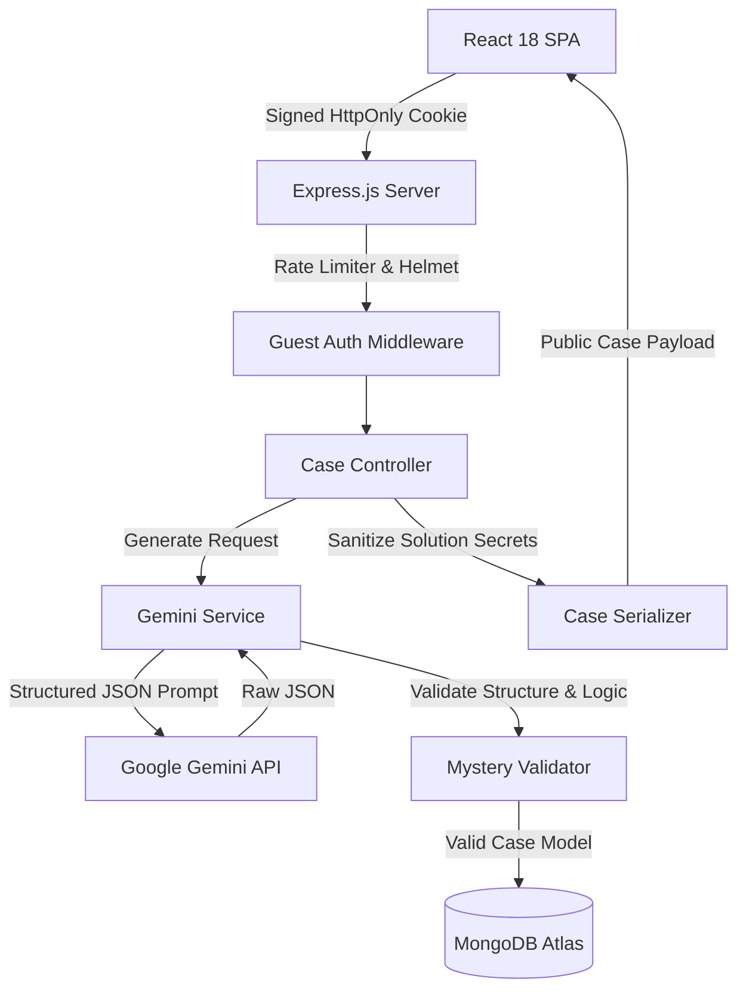

# AI Mystery Room 🕵️‍♂️🔍

> **An immersive Dark Detective Noir web application where players investigate procedurally generated crimes architected by Google Gemini, interrogate suspects, examine physical evidence on a realistic corkboard, request precinct hints, deliver final accusations, and earn deterministic scores.**

[](https://nodejs.org/)
[](https://react.dev/)
[](https://ai.google.dev/)
[](https://www.mongodb.com/atlas)
[](https://tailwindcss.com/)
[](LICENSE)

---

## 📖 Table of Contents

1. [Overview & Concept](#-overview--concept)
2. [Key Features](#-key-features)
3. [Dark Detective Noir Design Identity](#-dark-detective-noir-design-identity)
4. [Technology Stack](#-technology-stack)
5. [System Architecture](#-system-architecture)
6. [Folder Structure](#-folder-structure)
7. [Prerequisites](#-prerequisites)
8. [Environment Variables](#-environment-variables)
9. [Local Installation & Setup](#-local-installation--setup)
10. [Running the Application](#-running-the-application)
11. [Automated Testing Suite](#-automated-testing-suite)
12. [API Reference & Contracts](#-api-reference--contracts)
13. [Scoring System & Math](#-scoring-system--math)
14. [Security & Zero-Leakage Architecture](#-security--zero-leakage-architecture)
15. [Deployment Guide](#-deployment-guide)
16. [Verification Checklist](#-verification-checklist)

---

## 🔍 Overview & Concept

**AI Mystery Room** places players in the shoes of a mid-20th-century private investigator. Rather than static, pre-written puzzles with zero replay value, each case is synthesized live using Google's official `@google/genai` SDK and strictly validated through structural and logical constraints.

Players inspect suspect dossiers, review sworn alibis, unseal forensic evidence cards on a tactile corkboard, connect clues, request strategic precinct hints, and make a formal final indictment.

### Core Philosophy:
- **No Hallucinated Plot Holes:** Zod runtime validation guarantees every case has exactly one culprit, at least 2 distinct supporting forensic clues, and verifiable innocent suspect alibis.
- **Zero Client-Side Spoilers:** The backend enforces an airtight information barrier. Solution details, culprit IDs, and undiscovered clue facts are strictly stripped before network transmission.
- **Deterministic Scoring:** Deductive performance is calculated objectively on the backend. No score manipulation via client request manipulation.

---

## ✨ Key Features

- **Procedural Crime Architect:** Generate mysteries across 3 difficulty tiers:
  - **Easy:** 3 suspects, 5 clues, 2 hints (Base: 100 Pts)
  - **Medium:** 4 suspects, 7 clues, 3 hints (Base: 150 Pts)
  - **Hard:** 5 suspects, 9 clues, 3 hints (Base: 200 Pts)
- **Tactile Physical Corkboard:** Dark cork-textured workspace with pinned cards, category markers (Physical, Testimony, Document, Forensic), and connected twine lines.
- **Dossier Profiles & Silhouettes:** Handcrafted atmospheric Noir portrait avatars with rich backstories and alibis.
- **Progressive Clue Discovery:** Unseal microscopic analysis and lab notes on the evidence board for +5 points per clue.
- **Strategic Precinct Hints:** Request subtle deductive guidance from precinct archives with -10 point penalties (bounded by difficulty quota).
- **Formal Accusation Interrogation:** Dramatic single-suspect indictment with confirmation safeguards and irreversible verdicts.
- **Cinematic Case Debrief:** Full post-mortem reveal with canonical crime reconstruction, supporting evidence breakdown, itemized scorecard, and victory celebration.
- **Persistent Guest Archives:** Signed, HttpOnly cookies (`agy_guest_id`) securely track case histories in MongoDB Atlas without requiring intrusive user accounts.
- **Tactile Audio Experience:** Optional Web Audio API synthesis: typewriter keyclicks, pin thumps, clue discovery chimes, and ambient rain background.

---

## 🎨 Dark Detective Noir Design Identity

| Design Token | Hex | Semantic Role |
|---|---|---|
| Primary background | `#101113` | Deepest shadow layer, application foundation |
| Secondary background | `#1B1D20` | Section backgrounds, card containers |
| Card surface | `#222326` | Dossiers, evidence cards, modal dialogs |
| Elevated surface | `#292A2D` | Hover states, active tabs, floating tooltips |
| Primary accent | `#C69B52` | Antique gold CTA buttons, badges, key labels |
| Accent hover | `#D5AD6C` | Gold hover transitions, active highlights |
| Primary text | `#E8E2D5` | Cream headings, primary body copy |
| Secondary text | `#A29D94` | Parchment descriptions, supporting metadata |
| Muted text | `#77736C` | Timestamps, inactive labels, borders |
| Danger crimson | `#8F3939` | Incorrect accusation, warnings, danger markers |
| Success olive | `#687D60` | Correct accusation, solved badge, valid clues |
| Structural border | `#343438` | Structural subtle borders and dividers |

### Typography
- **Headings & Titles:** `Playfair Display`, serif.
- **Body & Controls:** `Inter`, sans-serif.
- **Metadata, IDs & Evidence Markers:** `JetBrains Mono`, monospace.

---

## 🛠️ Technology Stack

### Frontend (`/client`)
- **React 18.3** & **Vite 5.4**: Lightning-fast SPA architecture and optimized bundling.
- **Tailwind CSS 3.4**: Custom design tokens, paper drop shadows, and corkboard styling.
- **React Router DOM 6.29**: Dynamic SPA routing (`/`, `/create`, `/case/:id`, `/case/:id/accuse`, `/case/:id/result`, `/history`).
- **Axios 1.7**: Standardized HTTP client with credentials and JSON headers.
- **Lucide React**: Crisp detective iconography.
- **Canvas Confetti**: Celebratory solved animation.
- **React Hot Toast**: Dark Noir alert toasts.

### Backend (`/server`)
- **Node.js (>=18.0.0)** & **Express 4.21**: Robust modular REST architecture.
- **Mongoose 8.10** & **MongoDB Atlas**: Document database for persistent cases and guest histories.
- **Google GenAI (`@google/genai`)**: Official Gemini API client.
- **Zod 3.24**: Runtime schema validation for requests and Gemini responses.
- **Helmet 8.0**: Hardened security HTTP headers.
- **CORS 2.8**: Origin whitelisting with credential support.
- **Express Rate Limit 7.5**: DOS protection and rate limits.
- **Cookie Parser 1.4**: HMAC-signed guest session management.
- **Node Native Test Runner**: Built-in, ultra-fast test suite (`node --test`).

---

## 📐 System Architecture



---

## 📂 Folder Structure

```
AI-MYSTERY-ROOM/
│
├── SPEC.md                      # Comprehensive Technical Specification
├── README.md                    # Project Documentation
├── package.json                 # Root script orchestration
├── render.yaml                  # Render deployment configuration
├── .gitignore
│
├── client/                      # Frontend Application
│   ├── public/
│   │   ├── favicon.svg
│   │   └── images/
│   ├── src/
│   │   ├── components/
│   │   │   ├── common/          # Button, Badge, Modal, LoadingDossier
│   │   │   ├── layout/          # Navbar, Footer, Layout
│   │   │   ├── mystery/         # CaseHeader, CaseStoryModal, HintDrawer
│   │   │   ├── suspects/        # SuspectCard, SuspectModal, SuspectAvatar
│   │   │   ├── evidence/        # Corkboard, EvidenceCard, EvidenceModal
│   │   │   └── results/         # ScoreCard, SolutionReveal
│   │   ├── context/
│   │   │   └── SoundContext.jsx # Web Audio API sound synthesis & ambience
│   │   ├── pages/
│   │   │   ├── Home.jsx
│   │   │   ├── CreateMystery.jsx
│   │   │   ├── InvestigationRoom.jsx
│   │   │   ├── Accusation.jsx
│   │   │   ├── Results.jsx
│   │   │   ├── CaseHistory.jsx
│   │   │   └── NotFound.jsx
│   │   ├── services/
│   │   │   └── api.js           # Axios caseService client
│   │   ├── styles/
│   │   │   └── index.css        # Tailwind + Noir utilities
│   │   ├── App.jsx
│   │   └── main.jsx
│   ├── package.json
│   ├── tailwind.config.js
│   ├── vite.config.js
│   └── vercel.json
│
└── server/                      # Backend Application
    ├── src/
    │   ├── config/
    │   │   ├── database.js      # Mongoose connection logic
    │   │   └── gemini.js        # Google GenAI initialization
    │   ├── controllers/
    │   │   ├── caseController.js
    │   │   ├── clueController.js
    │   │   ├── hintController.js
    │   │   ├── accusationController.js
    │   │   └── historyController.js
    │   ├── middleware/
    │   │   ├── errorHandler.js
    │   │   ├── guestAuth.js     # Signed guest cookie generation
    │   │   └── rateLimiter.js
    │   ├── models/
    │   │   └── Case.js          # Mongoose Case model
    │   ├── routes/
    │   │   ├── caseRoutes.js
    │   │   └── historyRoutes.js
    │   ├── services/
    │   │   ├── caseSerializer.js # Information barrier security
    │   │   ├── geminiService.js  # Gemini structured generation
    │   │   ├── mysteryValidator.js # Zod validation & solvability rules
    │   │   └── scoringService.js # Deterministic score math
    │   ├── validators/
    │   │   └── caseValidator.js
    │   ├── app.js
    │   └── server.js
    ├── tests/
    │   ├── caseSerializer.test.js
    │   ├── mysteryValidator.test.js
    │   └── scoringService.test.js
    ├── package.json
    └── .env.example
```

---

## ⚡ Prerequisites

- **Node.js**: v18.0.0 or higher (`node -v` to check).
- **npm**: v9.0.0 or higher.
- **MongoDB**: Active MongoDB Atlas connection URI or local instance (`mongodb://localhost:27017/ai_mystery_room`).
- **Google Gemini API Key**: Obtain a key from [Google AI Studio](https://aistudio.google.com/).

---

## 🔐 Environment Variables

### Backend (`server/.env`)
Create `server/.env` based on `server/.env.example`:

```env
PORT=5000
NODE_ENV=development
CLIENT_URL=http://localhost:3000

# MongoDB Connection String (Atlas URI or local)
MONGODB_URI=mongodb+srv://<username>:<password>@cluster0.mongodb.net/ai_mystery_room?retryWrites=true&w=majority

# Google Gemini API Key
GEMINI_API_KEY=your_gemini_api_key_here
GEMINI_MODEL=gemini-3.8-flash

# Signed Cookie Secret (HMAC)
SESSION_SECRET=noir_detective_case_secret_key_change_in_production
```

### Frontend (`client/.env`)
Create `client/.env` based on `client/.env.example`:

```env
# In development, leave default to use Vite proxy
VITE_API_URL=/api

# In production on Vercel, point to your deployed Render backend:
# VITE_API_URL=https://ai-mystery-room-server.onrender.com/api
```

---

## 🚀 Local Installation & Setup

1. **Clone the repository:**
   ```bash
   git clone https://github.com/your-username/ai-mystery-room.git
   cd ai-mystery-room
   ```

2. **Install Server Dependencies:**
   ```bash
   cd server
   npm install
   ```

3. **Install Client Dependencies:**
   ```bash
   cd ../client
   npm install
   ```

---

## 🎮 Running the Application

### Option A: Run Both in Parallel (Two Terminals)

**Terminal 1 (Backend API):**
```bash
cd server
npm run dev
# Starts on http://localhost:5000
```

**Terminal 2 (Frontend Client):**
```bash
cd client
npm run dev
# Starts on http://localhost:3000
```

Open your browser at `http://localhost:3000` to enter the detective bureau!

---

## 🧪 Automated Testing Suite

The project includes unit and integration tests covering scoring algorithms, logical solvability validators, and the information barrier serializer.

To execute tests:
```bash
cd server
npm test
```

Expected output:
```
▶ Case Serializer (Information Barrier Security)
  ✔ strictly hides solution from active case payload
  ✔ redacts details and relevance for undiscovered clues in active cases
  ✔ redacts text of unused hints in active cases
  ✔ reveals complete solution and debrief when case status is completed
  ✔ history serialization never exposes solutions of active cases
✔ Case Serializer (Information Barrier Security)
▶ Mystery Validator
  ✔ successfully validates a well-formed Easy mystery
  ✔ rejects mystery with incorrect suspect count for difficulty
  ✔ rejects mystery with incorrect clue count for difficulty
  ✔ rejects mystery where culpritId does not match any suspect
  ✔ rejects mystery where supportingClueIds references invalid clue
  ✔ rejects mystery with duplicate suspect IDs
✔ Mystery Validator
▶ Scoring Service
  ✔ calculates intermediate score accurately
  ✔ enforces 0 minimum floor for progress score
  ✔ calculates Easy difficulty score correctly
  ✔ calculates Medium difficulty score correctly
  ✔ calculates Hard difficulty score correctly
  ✔ awards 0 base points on incorrect accusation
  ✔ strictly clamps final score to 0 and never returns negative numbers
✔ Scoring Service
ℹ tests 18, suites 6, pass 18, fail 0
```

---

## 📋 API Reference & Contracts

All endpoints return standardized JSON:
- **Success:** `{ "success": true, "data": { ... } }`
- **Error:** `{ "success": false, "message": "...", "code": "ERROR_CODE" }`

### 1. Generate Mystery
- **Route:** `POST /api/cases`
- **Rate Limit:** 30 requests/hour per IP
- **Request Body:**
  ```json
  {
    "premise": "A rare 18th-century violin was stolen from a locked dressing room.",
    "difficulty": "medium"
  }
  ```
- **Response (201 Created):**
  Returns sanitized public case file with `solution` omitted, unexamined clue `details` redacted, and unused hint `text` redacted.

### 2. Retrieve Active Case
- **Route:** `GET /api/cases/:id`
- **Response (200 OK):**
  Returns case dossier, discovered clues with unlocked forensic details, and remaining hint quotas.

### 3. Discover Clue
- **Route:** `POST /api/cases/:id/clues/:clueId/discover`
- **Response (200 OK):**
  ```json
  {
    "success": true,
    "clue": {
      "id": "clue_1",
      "title": "Scratched Latch",
      "details": "Microscopic analysis reveals rosin dust matching audio technician toolkit.",
      "discovered": true
    },
    "progress": {
      "discoveredCluesCount": 1,
      "currentScore": 5
    }
  }
  ```

### 4. Request Hint
- **Route:** `POST /api/cases/:id/hints`
- **Response (200 OK):**
  Returns next sequential hint text, reduces remaining hint quota, and applies -10 point penalty.

### 5. Submit Accusation
- **Route:** `POST /api/cases/:id/accuse`
- **Request Body:**
  ```json
  {
    "suspectId": "suspect_3"
  }
  ```
- **Response (200 OK):**
  Transitions case to `completed`, computes final score, reveals true culprit dossier, and unseals canonical solution narrative.

### 6. Case History
- **Route:** `GET /api/cases/history`
- **Response (200 OK):**
  Returns array of past cases associated with the current signed guest cookie.

### 7. Health Check
- **Route:** `GET /api/health`
- **Response (200 OK):**
  ```json
  {
    "status": "healthy",
    "service": "AI Mystery Room Backend",
    "database": "connected"
  }
  ```

---

## 🏆 Scoring System & Math

All scoring is executed deterministically on the server:

$$\text{Final Score} = \max\left(0, \text{Base Points} + (\text{Discovered Clues} \times 5) - (\text{Used Hints} \times 10)\right)$$

### Difficulty Base Points
| Difficulty | Correct Accusation | Incorrect Accusation |
|---|---|---|
| **Easy** | 100 points | 0 points |
| **Medium** | 150 points | 0 points |
| **Hard** | 200 points | 0 points |

- **Clue Bonus:** +5 points per clue discovered prior to accusation.
- **Hint Penalty:** -10 points per hint requested from precinct.
- **Minimum Floor:** 0 points (score is never negative).

---

## 🛡️ Security & Zero-Leakage Architecture

1. **Backend-Only AI Keys:** `GEMINI_API_KEY` is strictly confined to `server/src/config/gemini.js` and never forwarded to browser bundles or headers.
2. **Information Barrier:** The serializer (`caseSerializer.js`) guarantees that while a case is `active`:
   - `solution.culpritId` is deleted.
   - `solution.explanation` is deleted.
   - `solution.supportingClueIds` is deleted.
   - Undiscovered clue `details` and `relevance` are stripped.
   - Unused hint `text` is stripped.
3. **Signed Guest Session:** Cryptographic UUIDs (`crypto.randomUUID()`) signed with HMAC secret and stored in `HttpOnly`, `SameSite: Lax` cookies prevent cross-session snooping.
4. **Anti-Cheat:** Frontend cannot submit score values, clue counts, or hint quotas.

---

## 🌐 Deployment Guide

### Deploying Database (MongoDB Atlas)
1. Create a free M0 cluster on [MongoDB Atlas](https://www.mongodb.com/atlas).
2. Create a database user with read/write access.
3. In Network Access, allow IP `0.0.0.0/0` (standard for serverless/PaaS).
4. Copy the connection string: `mongodb+srv://<user>:<password>@cluster0.mongodb.net/ai_mystery_room?retryWrites=true&w=majority`.

### Deploying Backend (Render)
1. Push this repository to GitHub.
2. In [Render](https://render.com/), create a new **Web Service**.
3. Connect your repository:
   - **Root Directory:** `server`
   - **Build Command:** `npm install`
   - **Start Command:** `npm start`
4. In Environment Variables, configure:
   - `NODE_ENV=production`
   - `PORT=5000`
   - `MONGODB_URI=<your_mongodb_atlas_uri>`
   - `GEMINI_API_KEY=<your_google_gemini_api_key>`
   - `GEMINI_MODEL=gemini-3.8-flash`
   - `SESSION_SECRET=<random_secure_hex_secret>`
   - `CLIENT_URL=https://<your_vercel_app_domain>.vercel.app`
5. Deploy and note your backend URL: `https://<service-name>.onrender.com`.

### Deploying Frontend (Vercel)
1. In [Vercel](https://vercel.com/), import the GitHub repository.
2. Select **Root Directory:** `client`.
3. Framework Preset: **Vite**.
4. Configure Environment Variable:
   - `VITE_API_URL=https://<your-render-backend>.onrender.com/api`
5. Deploy. `vercel.json` ensures full client-side SPA routing support.

---

## ✅ Verification Checklist

- [x] Complete `SPEC.md` and `README.md` documented.
- [x] Dark Detective Noir visual theme strictly adhered to (no neon, antique gold accents).
- [x] Responsive layout verified on desktop, tablet, and mobile.
- [x] Physical corkboard evidence board with pinned cards, category tags, and yarn lines.
- [x] Google Gemini integration using official `@google/genai` SDK.
- [x] Zod structural and solvability validation with bounded retries.
- [x] Backend data barrier preventing solution leaks prior to accusation.
- [x] Clue discovery system awarding +5 points with duplicate prevention.
- [x] Progressive hint drawer with -10 point penalty and difficulty limits.
- [x] Accusation evaluation unsealing full debrief, culprit portrait, and itemized scorecard.
- [x] Persistent guest session and case history via signed HttpOnly cookies in MongoDB.
- [x] 18 automated tests passing for scoring, validation, and serializer security.
- [x] Production build validated with `vite build`.

---

**Built with pride by Antigravity Engineering for AI Mystery Room.**

#
