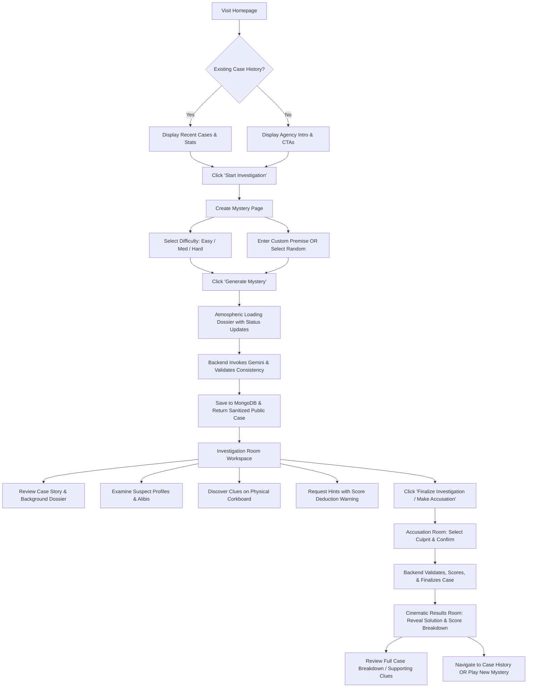

# AI Mystery Room — Technical Specification (SPEC.md)

**Single Source of Truth for Architecture, Design, and Implementation**  
**Version:** 1.0.0  
**Status:** Approved for Implementation  
**Target Deadline:** November 2, 2026  

---

## 1. Project Overview

**AI Mystery Room** is a full-stack, AI-powered detective investigation game where players step into a noir detective agency workspace to solve procedurally generated mysteries. Using Google's Gemini generative AI (`@google/genai`), the system synthesizes logically sound, multi-suspect criminal cases with interconnected clues, credible alibis, forensic evidence, and contextual hints.

Players examine realistic suspect dossiers, pin and connect evidence on an authentic physical corkboard interface, unlock clues progressively, request strategic hints, and deliver a formal final accusation against a single suspect. The platform evaluates deductive accuracy, computes objective performance scores, reveals the comprehensive post-case post-mortem, and persists guest case history in MongoDB Atlas without requiring invasive account creation.

---

## 2. Problem Statement

Traditional detective puzzle games suffer from two major flaws:
1. **Static Content Exhaustion:** Handcrafted mystery games have zero replayability once solved; players know the culprit and puzzle solutions permanently.
2. **Superficial AI Implementations:** Most AI game prototypes rely on unvalidated, hallucinated prompts where mysteries lack logical consistency, contain plot holes, lack solvable clues, or expose the culprit in client-side code / network payloads.

AI Mystery Room bridges this gap by combining generative AI with rigid schema validation, deterministic graph constraints, backend-enforced information barriers, and an evocative Dark Detective Noir physical workspace.

---

## 3. Product Objectives

1. **Procedural Replayability:** Generate endless distinct mysteries across 3 standardized difficulty tiers (Easy, Medium, Hard) adhering to strict narrative and forensic constraints.
2. **Guaranteed Logical Solvability:** Enforce via Zod and deterministic validation algorithms that every mystery features exactly one culprit with valid motive, means, and opportunity, backed by at least 2 distinct supporting clues and distinguishable from innocent suspects.
3. **Information Security & Anti-Cheat:** Guarantee zero leakage of secret solutions, culprit IDs, or undiscovered clue details to the browser before a valid accusation is evaluated by the backend.
4. **Cinematic Immersion:** Deliver a tactile, authentic detective experience featuring a physical corkboard, realistic suspect profiles, pinned evidence, yarn connections, typewriter/case-file aesthetics, and optional ambient audio.
5. **Zero-Friction Guest Identity:** Enable instant play and persistent case histories using secure, signed, HttpOnly guest session cookies tied to MongoDB Atlas.
6. **Production Grade Architecture:** Complete separation of concerns, containerizable structure, resilient error recovery, rate limiting, and automated test suite coverage.

---

## 4. Target Audience

- Fans of detective fiction, murder mysteries, and escape rooms (Sherlock Holmes, Agatha Christie, True Detective).
- Gamers seeking intellectual, deduction-based puzzle experiences without twitch reflexes.
- AI enthusiasts and software engineers evaluating production-grade generative AI system design and structured data generation.

---

## 5. User Journey



---

## 6. Functional Requirements

### 6.1 Mystery Generation
- **FR-1.1:** System shall accept user-defined mystery premise text (multiline up to 500 characters) or automatically assign an evocative premise if left blank.
- **FR-1.2:** System shall support 3 strictly balanced difficulty tiers:
  - **Easy:** 3 suspects, 5 clues, 2 hints.
  - **Medium:** 4 suspects, 7 clues, 3 hints.
  - **Hard:** 5 suspects, 9 clues, 3 hints.
- **FR-1.3:** System shall query Google Gemini via official `@google/genai` with strict JSON schema instructions.
- **FR-1.4:** System shall automatically validate structural integrity, ID references, suspect counts, clue counts, hint counts, and logical solvability before database persistence.
- **FR-1.5:** System shall perform bounded retries (up to 2 retries) if Gemini returns malformed or logically flawed responses.

### 6.2 Investigation Experience
- **FR-2.1:** Case dossier display: Title, case number (`CR-XXXXXX`), difficulty badge, opening story statement, and real-time investigation metrics.
- **FR-2.2:** Suspect profiles: Cards rendering portrait, full name, occupation, relationship, biography, alibi, and investigation status.
- **FR-2.3:** Physical Corkboard Evidence Board: Displays discovered clues as pinned cards/notes with categories (Physical, Testimony, Document, Forensic), item IDs, titles, descriptions, and connecting yarn links.
- **FR-2.4:** Clue Discovery: Players can discover unrevealed clues sequentially or by investigative inspection. Discovered clues award +5 points each. Already discovered clues cannot be rediscovered for additional points.
- **FR-2.5:** Hints: Players can request progressive guidance hints up to the difficulty limit. Each requested hint incurs a -10 point penalty. Hints must come from stored generated hints (not re-queried from AI). Once exhausted, further hints are blocked.

### 6.3 Accusation & Evaluation
- **FR-3.1:** Accusation interface allows selecting exactly one suspect from the official suspect roster.
- **FR-3.2:** Double-confirmation modal warns players that an accusation terminates the case permanently.
- **FR-3.3:** Backend verifies case ownership, active status, suspect existence, computes points, records outcome, and transitions case status to `completed`.
- **FR-3.4:** Only one final accusation is permitted per case (idempotent submission).

### 6.4 Results & Debrief
- **FR-4.1:** Cinematic reveal of accusation verdict: SOLVED (Gold) vs. UNSOLVED / WRONGFUL ACCUSATION (Crimson).
- **FR-4.2:** Complete disclosure of actual culprit, culprit portrait, full narrative explanation, and supporting clues.
- **FR-4.3:** Transparent score breakdown: Base points, clue bonuses, hint deductions, and net final score.
- **FR-4.4:** Direct navigation to "Case History" or "New Investigation".

### 6.5 Guest Session & History
- **FR-5.1:** Seamless guest onboarding via signed HttpOnly cookie `agy_guest_id`.
- **FR-5.2:** Case history page lists all cases generated by the guest ID, sorted newest first.
- **FR-5.3:** Completed cases link to the full result debrief. Active cases link back to the active investigation room.
- **FR-5.4:** Private solution fields are never exposed in case history for active cases.

---

## 7. Non-Functional Requirements

- **Performance:** Mystery generation completed within 4–12 seconds; all game interaction endpoints (clue discovery, hint, accusation) respond in < 150ms.
- **Security:** Zero client-side leakage of solution keys; HTTP-only signed cookies with CSRF defense, helmet security headers, sanitized HTML output, and express rate-limiting.
- **Reliability:** Graceful handling of Gemini API downtimes or rate limits with humanized diagnostic errors and retry buttons.
- **Usability & Accessibility:** Fully responsive down to 360px screen width; WCAG AA contrast ratio compliance on all primary text (#E8E2D5 on #101113 is 13.8:1); reduced motion query support; sound muted by default.
- **Maintainability:** Strict separation between routes, controllers, services, models, and validation schemas.

---

## 8. Technology Stack

### Frontend
| Component | Technology | Version | Purpose |
|---|---|---|---|
| Core Framework | React | ^18.3.1 | Component-driven UI architecture |
| Build Tool | Vite | ^5.4.0 | Fast HMR and optimized production bundling |
| Routing | React Router DOM | ^6.26.0 | Client-side SPA routing and guards |
| Styling | Tailwind CSS | ^3.4.10 | Utility-first styling with custom design tokens |
| Icons | Lucide React | ^0.435.0 | Consistent noir-styled UI iconography |
| HTTP Client | Axios | ^1.7.4 | Configured API client with cookie credentials |
| Notifications | React Hot Toast | ^2.4.1 | Dark noir alert toasts |
| Canvas/Effects | Canvas Confetti | ^1.9.3 | Victorious case solved reveal celebration |

### Backend
| Component | Technology | Version | Purpose |
|---|---|---|---|
| Runtime | Node.js | >= 18.0.0 | JavaScript runtime |
| Framework | Express.js | ^4.19.2 | REST API routing and middleware |
| Database | MongoDB Atlas | 7.0+ | Document database for persistent cases |
| ODM | Mongoose | ^8.5.2 | Object modeling, validation, and schema definitions |
| AI SDK | `@google/genai` | ^0.1.1 | Official Google Gemini GenAI SDK |
| Schema Validation | Zod | ^3.23.8 | Strict runtime validation of requests & AI output |
| Security | Helmet | ^7.1.0 | Standard HTTP security headers |
| CORS | Cors | ^2.8.5 | Origin whitelisting with credential support |
| Rate Limiting | express-rate-limit | ^7.4.0 | DOS and brute force protection |
| Cookies | cookie-parser | ^1.4.6 | Signed HttpOnly guest cookie handling |
| Environment | dotenv | ^16.4.5 | Secure local environment variable loading |

---

## 9. UI/UX Design System: Dark Detective Noir

### 9.1 Design Identity
The visual identity captures the atmosphere of a rainy 1940s-1950s private eye's office: mahogany, aged paper, typewriter carbon copies, dim amber streetlamp glow, and crime-scene corkboards strung with red twine.

### 9.2 Color Tokens

| Design Token | Hex Code | Semantic Role |
|---|---|---|
| `bg-noir-950` (Primary Background) | `#101113` | Main app background, darkest shadow layer |
| `bg-noir-900` (Secondary Background) | `#1B1D20` | Section backgrounds, card containers |
| `bg-noir-800` (Card Surface) | `#222326` | Dossiers, evidence cards, modal dialogs |
| `bg-noir-700` (Elevated Surface) | `#292A2D` | Hover states, active tabs, floating tooltips |
| `border-noir-600` (Border Default) | `#343438` | Structural subtle borders, dividers |
| `accent-gold` (Primary Accent) | `#C69B52` | Antique gold CTA buttons, badges, key labels |
| `accent-gold-hover` | `#D5AD6C` | Gold hover transitions, active highlights |
| `text-cream` (Primary Text) | `#E8E2D5` | Primary headings and body copy |
| `text-parchment` (Secondary Text) | `#A29D94` | Supporting descriptions, metadata |
| `text-muted` (Muted Text) | `#77736C` | Timestamps, inactive labels, borders |
| `danger-crimson` (Danger / Wrong) | `#8F3939` | Incorrect accusation, warnings, danger evidence |
| `success-olive` (Success / Solved) | `#687D60` | Correct accusation, solved badge, valid clues |

### 9.3 Typography
- **Headings & Cinematic Titles:** `Playfair Display`, serif (weights 600, 700, 900).
- **Body & Controls:** `Inter`, sans-serif (weights 400, 500, 600).
- **Metadata, IDs & Evidence Markers:** `JetBrains Mono` or `Courier New`, monospace (weights 400, 500).

### 9.4 Physical Corkboard Aesthetic
- Textured dark corkboard canvas (`#161412` with subtle repeating cork grain pattern or styled CSS texture).
- Polaroids & Evidence Cards: Tilted randomly between -2deg and +2deg with realistic dropped drop-shadows.
- Pinned markers: Red and antique brass pin heads at the top center of evidence cards.
- SVG Twine / Yarn: SVG connecting lines drawn between related evidence items on desktop viewports.

---

## 10. Page Specifications

### 10.1 Home Page (`/`)
- Hero banner with cinematic detective office silhouette, fog/dust particles.
- Tagline: *"Every mystery has a truth waiting to be uncovered."*
- Supporting copy: *"Step into the investigation. Examine evidence, question the details, uncover hidden connections and discover who is responsible."*
- Primary CTA: **"Start Investigation"** (links to `/create`).
- Secondary CTA: **"Explore How It Works"** (smooth scrolls to visual 3-step breakdown).
- Recent Active/Completed Cases carousel if user has existing cases.
- System Status indicator badge (`Gemini 2.5/Flash AI Connected` / `Database Online`).
- Footer with project specifications and credits.

### 10.2 Create Mystery Page (`/create`)
- Dossier-style mystery creator.
- Multi-line premise input with helpful presets (e.g. *"A locked penthouse vault"*, *"A poisoned gala toast"*, *"A vanished renaissance manuscript"*).
- Random premise trigger: *"Can't decide? Generate an enigmatic random premise."*
- Three interactive Difficulty Cards with clear stats:
  - **Easy:** 3 Suspects • 5 Clues • 2 Hints (Base: 100 Pts)
  - **Medium:** 4 Suspects • 7 Clues • 3 Hints (Base: 150 Pts)
  - **Hard:** 5 Suspects • 9 Clues • 3 Hints (Base: 200 Pts)
- Cinematic Generation Overlay: Animated typewriter indicator rotating realistic investigation logs:
  - *"Drafting incident report from precinct dispatch..."*
  - *"Correlating forensic toxicology logs..."*
  - *"Cross-examining witness statements..."*
  - *"Constructing evidence board..."*

### 10.3 Investigation Room (`/case/:id`)
- **Case Header Bar:** Case Number, Title, Difficulty, Clues Found counter (`3/7`), Hints Left (`2/3`), Current Deductive Score, and quick jump to Accusation.
- **Tabbed or Split Layout:**
  - **Evidence Corkboard Tab (Default):** Interactive physical corkboard rendering all discovered clues as pinned cards, with category filters and an interactive "Search for Clues / Interrogate Scene" discovery trigger.
  - **Suspects Dossier Tab:** Realistic suspect portrait cards displaying occupation, relationship to victim/incident, alibi, motive suspicion, and interactive "Review Alibi" modal.
  - **Case Story & Case Notes:** Expandable detective journal containing the full opening story statement.
- **Hint Panel:** Drawer or sidebar allowing players to request a hint with instant feedback and score penalty confirmation.
- **Accusation Action:** Prominent gold button leading to `/case/:id/accuse`.

### 10.4 Accusation Page (`/case/:id/accuse`)
- Dramatic Noir interrogation lighting.
- Headline: *"Final Indictment — Name the Culprit"*.
- Suspect selection grid: Each suspect rendered with their full portrait and occupation.
- Single-choice radio/card selection state with glowing gold borders.
- Confirmation Modal: *"Are you certain this is the person responsible? This action is permanent and will finalize the official case record."*
- Submit Accusation action sends payload to `/api/cases/:id/accuse` and transitions to `/case/:id/result`.

### 10.5 Results Page (`/case/:id/result`)
- Verdict banner:
  - **Case Solved:** Golden badge with typewriter message: *"Case Closed — Perpetrator Apprehended"*.
  - **Accusation Incorrect:** Crimson badge: *"Case Unresolved — Wrongful Accusation Filed"*.
- True Culprit Dossier: Large portrait, full name, motive, and opportunity breakdown.
- Solution Narrative: The full canonical explanation generated by the AI detailing how the crime was executed and how innocent suspects are eliminated.
- Key Supporting Evidence: List of supporting clues that directly established the culprit's guilt.
- Itemized Scorecard:
  - Base Score: +100 / +150 / +200 (or 0 if incorrect)
  - Clue Discovery Bonus: `+ (Discovered Clues × 5)`
  - Hint Deductions: `- (Used Hints × 10)`
  - **Final Net Score:** Calculated total (minimum 0).
- Actions: **"Review Case File"**, **"View Case History"**, and **"Start New Investigation"**.

### 10.6 Case History Page (`/history`)
- Chronological list of all cases owned by the current guest session.
- Filters: All, Solved, Unsolved, Active.
- Case card displays: Case Title, Case Number, Difficulty, Date, Final Score or Current Status, and direct link to Result or Investigation Room.
- Empty state: Noir folder graphic with *"No case files recorded in your archives yet."*

### 10.7 Not Found (`*`)
- Atmospheric 404 screen styled as a missing or classified police record.

---

## 11. Frontend Architecture

```
client/
├── public/
│   ├── images/
│   │   ├── corkboard-bg.png
│   │   ├── detective-hero.jpg
│   │   └── portraits/ (diverse detective noir avatar SVGs/assets)
│   ├── sounds/
│   │   ├── ambient-rain.mp3
│   │   ├── clue-discover.mp3
│   │   └── typewriter-click.mp3
│   └── favicon.svg
├── src/
│   ├── assets/
│   ├── components/
│   │   ├── common/
│   │   │   ├── Button.jsx
│   │   │   ├── Modal.jsx
│   │   │   ├── Badge.jsx
│   │   │   ├── AudioPlayer.jsx
│   │   │   └── LoadingDossier.jsx
│   │   ├── layout/
│   │   │   ├── Navbar.jsx
│   │   │   ├── Footer.jsx
│   │   │   └── Layout.jsx
│   │   ├── mystery/
│   │   │   ├── CaseHeader.jsx
│   │   │   ├── CaseStoryModal.jsx
│   │   │   └── HintDrawer.jsx
│   │   ├── suspects/
│   │   │   ├── SuspectCard.jsx
│   │   │   ├── SuspectModal.jsx
│   │   │   └── SuspectAvatar.jsx
│   │   ├── evidence/
│   │   │   ├── Corkboard.jsx
│   │   │   ├── EvidenceCard.jsx
│   │   │   ├── EvidenceModal.jsx
│   │   │   └── YarnConnection.jsx
│   │   └── results/
│   │       ├── ScoreCard.jsx
│   │       └── SolutionReveal.jsx
│   ├── pages/
│   │   ├── Home.jsx
│   │   ├── CreateMystery.jsx
│   │   ├── InvestigationRoom.jsx
│   │   ├── Accusation.jsx
│   │   ├── Results.jsx
│   │   ├── CaseHistory.jsx
│   │   └── NotFound.jsx
│   ├── context/
│   │   └── SoundContext.jsx
│   ├── services/
│   │   └── api.js
│   ├── utils/
│   │   ├── formatters.js
│   │   └── soundEffects.js
│   ├── styles/
│   │   └── index.css
│   ├── App.jsx
│   └── main.jsx
├── index.html
├── package.json
├── tailwind.config.js
└── vite.config.js
```

---

## 12. Backend Architecture

```
server/
├── src/
│   ├── config/
│   │   ├── database.js      # Mongoose connection with retry logic
│   │   └── gemini.js        # Google GenAI client instance
│   ├── controllers/
│   │   ├── caseController.js    # Case creation, retrieval, public serialization
│   │   ├── clueController.js    # Clue discovery handler & scoring
│   │   ├── hintController.js    # Hint consumption & scoring
│   │   ├── accusationController.js # Accusation resolution & result finalization
│   │   └── historyController.js # Guest case history query
│   ├── models/
│   │   └── Case.js          # Unified Mongoose Case schema
│   ├── routes/
│   │   ├── caseRoutes.js    # /api/cases endpoints
│   │   └── historyRoutes.js # /api/cases/history endpoints
│   ├── services/
│   │   ├── geminiService.js     # Structured AI prompts & Gemini calling
│   │   ├── mysteryValidator.js  # Zod schemas & logical consistency verification
│   │   ├── scoringService.js    # Deterministic scoring calculation
│   │   └── caseSerializer.js    # Public/private info barrier serializer
│   ├── middleware/
│   │   ├── errorHandler.js  # Centralized error handler with standardized JSON
│   │   ├── guestAuth.js     # Signed cookie guest ID creation & verification
│   │   └── rateLimiter.js   # IP/Session rate limiting
│   ├── validators/
│   │   └── requestValidator.js # Zod validation for HTTP inputs
│   ├── app.js               # Express application configuration
│   └── server.js            # Server entry point
├── tests/
│   ├── mysteryValidator.test.js
│   ├── scoringService.test.js
│   ├── caseController.test.js
│   └── caseSerializer.test.js
├── .env.example
└── package.json
```

---

## 13. Database Schema

The unified `Case` schema encapsulates the complete lifecycle of a mystery, from initial AI generation through active discovery to completed verdict.

```javascript
// server/src/models/Case.js
const CaseSchema = new mongoose.Schema({
  caseNumber: {
    type: String,
    required: true,
    unique: true,
    index: true,
    uppercase: true, // e.g. "CR-892301"
  },
  ownerId: {
    type: String,
    required: true,
    index: true, // UUID from signed guest cookie
  },
  title: {
    type: String,
    required: true,
    trim: true,
  },
  story: {
    type: String,
    required: true,
  },
  premise: {
    type: String,
    trim: true,
    default: "A high-stakes crime of cunning and deception.",
  },
  difficulty: {
    type: String,
    required: true,
    enum: ["easy", "medium", "hard"],
    index: true,
  },
  status: {
    type: String,
    required: true,
    enum: ["active", "completed"],
    default: "active",
    index: true,
  },
  suspects: [
    {
      id: { type: String, required: true }, // e.g. "suspect_1"
      name: { type: String, required: true },
      occupation: { type: String, required: true },
      relationship: { type: String, required: true },
      biography: { type: String, required: true },
      alibi: { type: String, required: true },
      portraitDescription: { type: String, required: true },
      gender: { type: String, enum: ["male", "female", "neutral"], default: "neutral" },
      avatarIndex: { type: Number, default: 0 },
    }
  ],
  clues: [
    {
      id: { type: String, required: true }, // e.g. "clue_1"
      title: { type: String, required: true },
      description: { type: String, required: true }, // Initial teaser
      details: { type: String, required: true },     // Detailed forensic analysis
      category: {
        type: String,
        required: true,
        enum: ["physical", "testimony", "document", "forensic"],
      },
      relevance: { type: String, required: true },
      discovered: { type: Boolean, default: false },
      discoveredAt: { type: Date, default: null },
      boardPosition: {
        x: { type: Number, default: 0 },
        y: { type: Number, default: 0 },
        rotation: { type: Number, default: 0 },
      }
    }
  ],
  hints: [
    {
      id: { type: String, required: true }, // e.g. "hint_1"
      text: { type: String, required: true },
      used: { type: Boolean, default: false },
      usedAt: { type: Date, default: null },
    }
  ],
  // PRIVATE SECRETS — Never serialized to client while status == "active"
  solution: {
    culpritId: { type: String, required: true }, // matches one of suspects[].id
    explanation: { type: String, required: true },
    supportingClueIds: [{ type: String }],
  },
  playerProgress: {
    discoveredClueIds: [{ type: String }],
    usedHintIds: [{ type: String }],
    currentScore: { type: Number, default: 0 },
  },
  accusation: {
    suspectId: { type: String, default: null },
    submittedAt: { type: Date, default: null },
    isCorrect: { type: Boolean, default: null },
  },
  result: {
    completed: { type: Boolean, default: false },
    basePoints: { type: Number, default: 0 },
    cluePoints: { type: Number, default: 0 },
    hintPenalty: { type: Number, default: 0 },
    finalScore: { type: Number, default: 0 },
  }
}, {
  timestamps: true
});
```

---

## 14. API Contracts

All endpoints return uniform response payloads:
- Success: `{ "success": true, "data": { ... } }`
- Error: `{ "success": false, "message": "...", "code": "ERROR_CODE" }`

### 14.1 POST `/api/cases`
Generate a new mystery.

**Request:**
```json
{
  "premise": "A rare 18th-century violin was stolen from a locked dressing room during a philharmonic gala.",
  "difficulty": "medium"
}
```

**Response (201 Created):**
```json
{
  "success": true,
  "data": {
    "case": {
      "id": "6724a1b091f1a4e5c83011a2",
      "caseNumber": "CR-784102",
      "title": "The Stolen Stradivarius",
      "story": "During the intermission of the autumn symphony...",
      "difficulty": "medium",
      "status": "active",
      "suspects": [
        {
          "id": "suspect_1",
          "name": "Elena Vance",
          "occupation": "Concertmaster",
          "relationship": "Lead soloist with primary access to the backstage corridor",
          "biography": "A virtuoso under intense financial pressure...",
          "alibi": "Claims she was tuning in the green room alone.",
          "portraitDescription": "A sharp-eyed woman in black performance attire",
          "avatarIndex": 1
        }
      ],
      "clues": [
        {
          "id": "clue_1",
          "title": "Scratched Dressing Room Latch",
          "description": "Signs of mechanical tampering on the brass lock.",
          "category": "physical",
          "discovered": false,
          "discoveredAt": null,
          "boardPosition": { "x": 120, "y": 80, "rotation": -1.5 }
        }
      ],
      "hintsTotal": 3,
      "hintsRemaining": 3,
      "progress": {
        "discoveredCluesCount": 0,
        "totalCluesCount": 7,
        "usedHintsCount": 0,
        "currentScore": 0
      },
      "createdAt": "2026-10-31T20:20:00.000Z"
    }
  }
}
```
*(Notice: `solution`, `details` of undiscovered clues, and `hints.text` are completely omitted)*

### 14.2 GET `/api/cases/:id`
Fetch active case state for the current guest.

**Response (200 OK):**
Returns the sanitized case object matching Section 14.1. Discovered clues include full `details`. Used hints include `text`.

### 14.3 POST `/api/cases/:id/clues/:clueId/discover`
Discover a specific clue.

**Response (200 OK):**
```json
{
  "success": true,
  "data": {
    "clue": {
      "id": "clue_1",
      "title": "Scratched Dressing Room Latch",
      "description": "Signs of mechanical tampering on the brass lock.",
      "details": "Microscopic examination reveals traces of black rosin and carbon residue matching a stage tech toolkit.",
      "category": "physical",
      "discovered": true,
      "discoveredAt": "2026-10-31T20:25:00.000Z",
      "boardPosition": { "x": 120, "y": 80, "rotation": -1.5 }
    },
    "progress": {
      "discoveredCluesCount": 1,
      "totalCluesCount": 7,
      "currentScore": 5
    }
  }
}
```

### 14.4 POST `/api/cases/:id/hints`
Request next progressive hint.

**Response (200 OK):**
```json
{
  "success": true,
  "data": {
    "hint": {
      "id": "hint_1",
      "text": "Check which suspect had access to specialized locksmith or audio stage tools before the intermission.",
      "usedAt": "2026-10-31T20:28:00.000Z"
    },
    "hintsRemaining": 2,
    "progress": {
      "usedHintsCount": 1,
      "currentScore": -5
    }
  }
}
```

### 14.5 POST `/api/cases/:id/accuse`
Submit the final indictment against a suspect.

**Request:**
```json
{
  "suspectId": "suspect_3"
}
```

**Response (200 OK):**
```json
{
  "success": true,
  "data": {
    "result": {
      "isCorrect": true,
      "verdict": "SOLVED",
      "accusedSuspectId": "suspect_3",
      "culprit": {
        "id": "suspect_3",
        "name": "Marcus Kane",
        "occupation": "Lead Sound Technician",
        "relationship": "Handled backstage audio equipment",
        "biography": "Former watchmaker with heavy gambling debts..."
      },
      "explanation": "Marcus Kane exploited his stage tech credentials to access the locked dressing room. Using modified audio pliers found in clue_1...",
      "supportingClues": [
        {
          "id": "clue_1",
          "title": "Scratched Dressing Room Latch",
          "relevance": "Direct toolmark match to stage technician toolkit."
        },
        {
          "id": "clue_4",
          "title": "Pawn Ticket in Equipment Trunk",
          "relevance": "Proves impending deadline for debt payment."
        }
      ],
      "score": {
        "difficulty": "medium",
        "basePoints": 150,
        "clueCount": 5,
        "cluePoints": 25,
        "hintCount": 1,
        "hintPenalty": 10,
        "finalScore": 165
      }
    }
  }
}
```

### 14.6 GET `/api/cases/:id/result`
Retrieve the finalized post-mortem debrief (only accessible once `status == 'completed'`).

### 14.7 GET `/api/cases/history`
Retrieve all cases owned by the requesting guest cookie.

**Response (200 OK):**
```json
{
  "success": true,
  "data": {
    "cases": [
      {
        "id": "6724a1b091f1a4e5c83011a2",
        "caseNumber": "CR-784102",
        "title": "The Stolen Stradivarius",
        "difficulty": "medium",
        "status": "completed",
        "isCorrect": true,
        "finalScore": 165,
        "completedAt": "2026-10-31T20:30:00.000Z"
      }
    ]
  }
}
```

### 14.8 GET `/api/health`
Health check endpoint reporting server uptime, database state, and environment configuration.

---

## 15. Gemini Integration & Structured Schema

### 15.1 Official SDK Usage
Integration uses `@google/genai` on the Node.js backend. Model name is dynamically pulled from `process.env.GEMINI_MODEL || "gemini-2.5-flash"`.

### 15.2 Prompt Strategy
System instruction enforces the persona of a master Agatha Christie / Raymond Chandler mystery architect. Gemini is strictly instructed to return raw JSON conforming to the target schema with no conversational markdown wrappers (` ```json `).

### 15.3 Target JSON Output Schema
```typescript
interface RawGeminiMystery {
  title: string;
  story: string;
  difficulty: "easy" | "medium" | "hard";
  suspects: Array<{
    id: string; // "suspect_1", "suspect_2", etc.
    name: string;
    occupation: string;
    relationship: string;
    biography: string;
    alibi: string;
    portraitDescription: string;
    gender: "male" | "female" | "neutral";
  }>;
  clues: Array<{
    id: string; // "clue_1", "clue_2", etc.
    title: string;
    description: string;
    details: string;
    category: "physical" | "testimony" | "document" | "forensic";
    relevance: string;
  }>;
  hints: Array<{
    id: string; // "hint_1", "hint_2", etc.
    text: string;
  }>;
  solution: {
    culpritId: string;
    explanation: string;
    supportingClueIds: string[];
  };
}
```

---

## 16. AI Response Validation & Logical Consistency

Before saving to MongoDB, the backend validates the raw AI output using **two layers**:

### 16.1 Layer 1: Strict Zod Structural Validation
- Validates field types, non-empty strings, and enum constraints (`category`, `difficulty`).
- Enforces ID formatting (e.g. `suspect_X`, `clue_Y`, `hint_Z`).
- Enforces difficulty-based item counts:
  - **Easy:** `suspects.length === 3`, `clues.length === 5`, `hints.length === 2`.
  - **Medium:** `suspects.length === 4`, `clues.length === 7`, `hints.length === 3`.
  - **Hard:** `suspects.length === 5`, `clues.length === 9`, `hints.length === 3`.

### 16.2 Layer 2: Deterministic Graph & Solvability Rules
- **Rule 1: Valid Culprit Reference.** `solution.culpritId` must match one of the suspects in `suspects[]`.
- **Rule 2: Minimum Supporting Evidence.** `solution.supportingClueIds` must contain at least 2 distinct clue IDs that all exist within `clues[]`.
- **Rule 3: Unique Identifiers.** All suspect IDs, clue IDs, and hint IDs must be strictly unique.
- **Rule 4: Innocent Suspect Alibis.** Non-culprit suspects must have alibis that do not contain internal self-contradictions.
- **Rule 5: Distinct Culprit Distinguisher.** At least one supporting clue must directly falsify or challenge the culprit's stated alibi or opportunity.

If any check fails, the backend logs the violation and triggers an automatic retry (up to 2 retries). If retries are exhausted, it throws `MYSTERY_GENERATION_FAILED`.

---

## 17. Clue & Hint Behavior

1. **Information Barrier:** Unlocked clues on the client board show only their `title`, `description` (general teaser), and `category`. The deep forensic `details` are locked on the backend until the player triggers `/api/cases/:id/clues/:clueId/discover`.
2. **Deterministic Discovery:** Clues can be discovered by inspecting points on the evidence board or investigating scene leads.
3. **Progressive Hints:** Hints are pre-generated by Gemini and stored in the database. When the player clicks "Request Hint", the backend serves the next unrevealed hint in sequence, marks `used: true`, timestamps it, and applies the -10 point penalty.
4. **No Spoilers:** Hints provide deductive guidance (e.g., *"Focus on the discrepancy in the visitor log timestamps"*) rather than naming the suspect directly.

---

## 18. Deterministic Scoring System

All scoring is calculated and authorized solely by the backend:

$$\text{Final Score} = \max\left(0, \text{Base Points} + (\text{Discovered Clues} \times 5) - (\text{Used Hints} \times 10)\right)$$

### Base Points:
- **Easy:** 100 points
- **Medium:** 150 points
- **Hard:** 200 points
- **Incorrect Accusation:** 0 base points (regardless of difficulty)

### Bonuses & Penalties:
- **Clue Discovery Bonus:** +5 points per unique clue discovered prior to accusation.
- **Hint Penalty:** -10 points per hint requested.
- **Floor:** Net score cannot drop below 0.

### Anti-Cheat Guarantees:
- Duplicate clue discovery requests return the existing record with 0 additional points.
- Hint penalties cannot be triggered beyond the maximum difficulty hint quota.
- Submitting an accusation freezes score calculation permanently.

---

## 19. Security & Privacy Architecture

1. **API Key Isolation:** `GEMINI_API_KEY` is referenced strictly in `server/src/config/gemini.js` and never forwarded to client-side bundles or headers.
2. **Guest Identity Protection:** Guest UUIDs are generated with `crypto.randomUUID()`, signed with `SESSION_SECRET`, and transmitted via `HttpOnly`, `SameSite: Lax` (or `None` with `Secure` in production) cookies.
3. **Data Redaction:** The `caseSerializer.js` utility strictly sanitizes database documents before JSON transmission:
   ```javascript
   // While case.status === 'active':
   delete sanitizedCase.solution;
   sanitizedCase.clues = case.clues.map(c => c.discovered ? c : omit(c, ['details', 'relevance']));
   sanitizedCase.hints = case.hints.filter(h => h.used);
   ```
4. **Input Sanitization & Protection:**
   - Helmet sets secure HTTP headers (X-Frame-Options, Content-Security-Policy, etc.).
   - Express rate limiters protect `/api/cases` (max 10 mystery creations per hour per IP) and game interactions (max 60 requests per minute).
   - Zod validates all route parameters and request bodies.

---

## 20. Error Handling Strategy

Standardized error format across all endpoints:
```json
{
  "success": false,
  "message": "Human-readable error explanation for the detective.",
  "code": "ERROR_CONSTANT_CODE"
}
```

| Error Code | HTTP Status | Description |
|---|---|---|
| `MYSTERY_GENERATION_FAILED` | 502 | Gemini API failed after retry limit |
| `CASE_NOT_FOUND` | 404 | Case ID does not exist |
| `UNAUTHORIZED_CASE_ACCESS` | 403 | Case does not belong to active guest cookie |
| `CASE_ALREADY_COMPLETED` | 400 | Attempted clue discovery or hint on finalized case |
| `CLUE_ALREADY_DISCOVERED` | 400 | Clue already marked discovered |
| `HINT_LIMIT_REACHED` | 400 | All allowed hints for difficulty tier have been consumed |
| `INVALID_SUSPECT_ACCUSATION` | 400 | Accused suspect ID is not registered in this case |
| `RATE_LIMIT_EXCEEDED` | 429 | Too many requests from this IP |
| `INTERNAL_SERVER_ERROR` | 500 | Unhandled exception |

---

## 21. Testing Strategy

Automated backend test suite powered by Node's native test runner / Jest / Supertest:

1. **Unit Tests:**
   - `mysteryValidator.test.js`: Validates detection of missing culprits, wrong clue counts, and unlinked supporting clues.
   - `scoringService.test.js`: Validates all scoring permutations (correct/incorrect, 0-floor enforcement, difficulty multipliers).
   - `caseSerializer.test.js`: Verifies that active cases never leak solutions, details, or unused hints.
2. **Integration Tests:**
   - Mocked Gemini responses test end-to-end case creation, clue discovery, hint limits, accusation submission, and history retrieval.
   - Rate limiting and ownership isolation tests.

---

## 22. Deployment Architecture

- **Frontend:** Vercel SPA deployment with `vercel.json` rewrite routing (`"rewrites": [{"source": "/(.*)", "destination": "/index.html"}]`).
- **Backend:** Render Web Service running Node.js (`npm start`), configured with health check `/api/health`.
- **Database:** MongoDB Atlas M0 cluster with secure IP access and automated TLS connection.
- **CORS & Cookies:** Production configuration aligns `CLIENT_URL` with credentials enabled.

---

## 23. Acceptance Criteria Checklist

- [x] Complete, unambiguous `SPEC.md` documented in root.
- [ ] Dark Detective Noir visual theme strictly adhered to (no neon, no purple, antique gold accent).
- [ ] Responsive UI verified on Desktop (1440x900), Tablet (768x1024), and Mobile (390x844).
- [ ] Physical corkboard evidence board with pinned cards, category tags, and yarn lines.
- [ ] Real Gemini API generation producing valid JSON for Easy (3/5/2), Medium (4/7/3), and Hard (5/9/3).
- [ ] Backend data barrier preventing solution leaks prior to accusation.
- [ ] Clue discovery mechanism updating state and persistent score.
- [ ] Progressive hints with strict difficulty quotas and score penalties.
- [ ] Accurate final accusation evaluation and debrief reveal.
- [ ] Persistent guest history via signed HttpOnly cookies in MongoDB.
- [ ] Automated test suite covering scoring, validation, and serialization.

---

## 24. Known Limitations

1. **Browser Cookie Clear:** If a player clears their browser cookies or switches browsers, their guest session UUID will reset, archiving previous cases under the orphaned ID unless authenticated accounts are introduced.
2. **AI Latency:** High load on Google's Gemini API endpoints may occasionally cause generation to take 8–15 seconds; mitigated via the animated loading dossier with rotating contextual messages.
